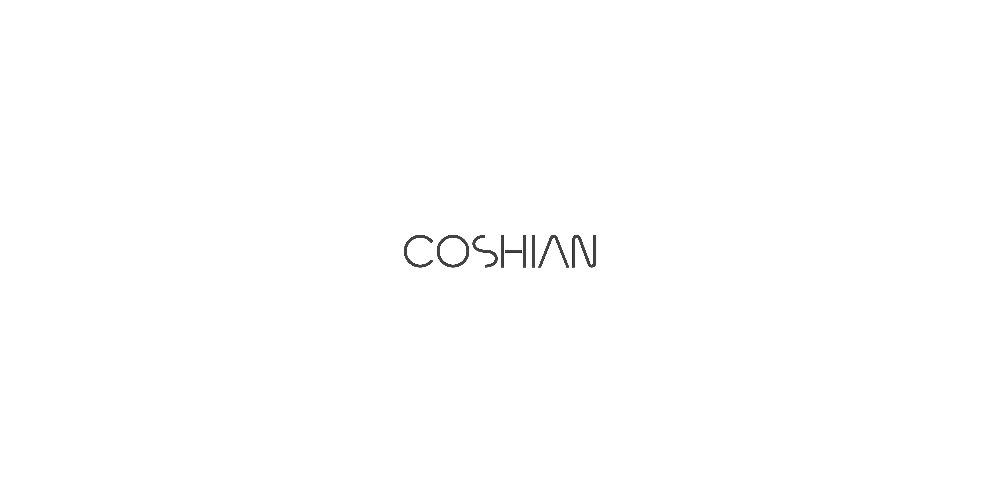
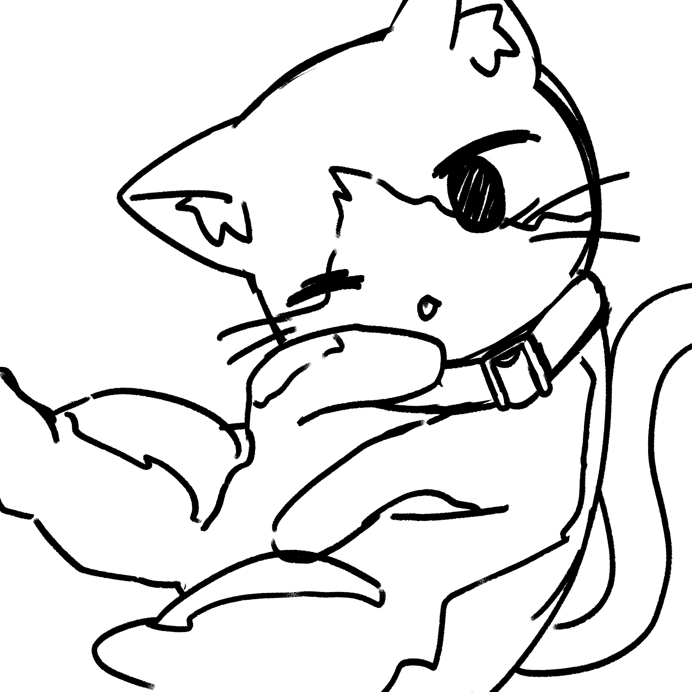

# こしあん / COSHIAN

## アイコン / Icon

  

## スキル / Skills

## プロフィール / Profile

## リポジトリ / Repository

<table>
  <tr>
    <td>
      
    </td>
    <td>
      
    </td>
  </tr>
</table>

## Links

### Website
- [Music by COSHIAN](https://studio.coshian.dev/music/)

### SNS
- [Instagram](https://www.instagram.com/coshian.music/)
- [X (Twitter)](https://twitter.com/COSHIAN_ofc)
- [YouTube](https://www.youtube.com/@COSHIAN_ofc)
- [SoundCloud](https://soundcloud.com/coshian_ofc)

## クレジット / Credits

### 日本語

`assets/` ディレクトリ内のアイコン画像は、外部のイラストレーターに依頼して制作されたものです。

**Copyright © 2026 Mike Sorakaze. All rights reserved.**

本イラストの著作権は、COSHIANではなく、制作者である宙風みけ氏に帰属します。

本イラストは、このリポジトリのライセンスの適用対象外です。リポジトリ内で公開されていることをもって、第三者による無断使用・再配布・改変が許可されるものではありません。

**イラスト制作：[宙風みけ](https://srmike.blue/)**

### English

The icon artwork in the `assets/` directory was commissioned from a third-party artist.

**Copyright © 2026 Mike Sorakaze. All rights reserved.**

The copyright of the artwork belongs to its original creator, Mike Sorakaze, not to COSHIAN.

The artwork is not covered by this repository's license. Its inclusion in this repository does not grant permission for reuse, redistribution, or modification.

**Illustration by [Mike Sorakaze](https://srmike.blue/)**

